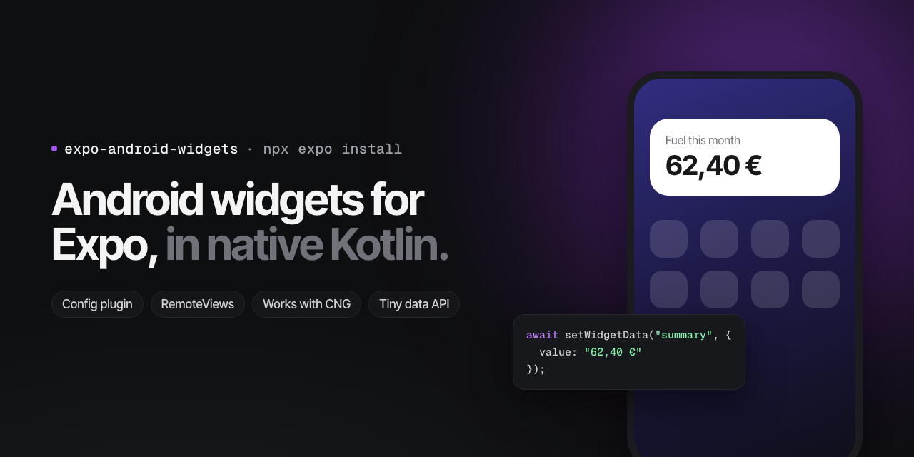
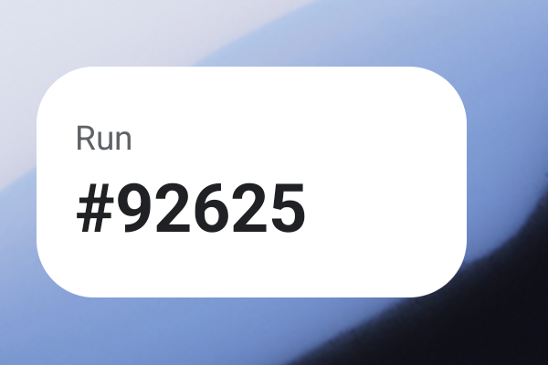

# expo-android-widgets



[](https://www.npmjs.com/package/expo-android-widgets)
[](https://github.com/rsoaresdev/expo-android-widgets/actions/workflows/ci.yml)
[](LICENSE)

**Native Android home screen widgets for Expo apps, written in Kotlin.** A config plugin adds your widget providers, layouts and resources to the Android project on every `expo prebuild`, so the `android` folder can stay out of git. A small API passes data from JavaScript to the widgets and redraws them.

Works with Continuous Native Generation (CNG), development builds and EAS Build, on Expo SDK 58 and later. Not available in Expo Go, like any native code.

```bash
npx expo install expo-android-widgets
```



The example widget on a Pixel emulator (Android 17), drawing a value the app stored with `setWidgetData`.

## Why native Kotlin

Android draws widgets with `RemoteViews`, in the launcher's process, while your app may not be running. This package lets you write them the way Android expects:

- **No JavaScript runs in the widget.** It draws instantly and keeps working when the app is closed.
- **Every Android widget feature is available:** `RemoteViews` layouts, collection widgets, configuration activities, `updatePeriodMillis`, alarms, broadcasts, Material You colours.
- **Your sources live in your project**, in a folder you choose, and the plugin keeps them in sync with the generated Android project.

If you prefer to describe widgets in JSX and do not need native code, [react-native-android-widget](https://github.com/sAleksovski/react-native-android-widget) is a good choice. This package is for the case where you want plain Android widgets in an Expo app.

## Quick start

### 1. Add your widget sources

Copy [`example/widgets/android`](example/widgets/android) into your project as `widgets/android`. It holds one complete widget:

```text
widgets/android/
  kotlin/SummaryWidget.kt                  the AppWidgetProvider
  res/layout/widget_summary.xml            its layout
  res/xml/widget_summary_info.xml          its size, preview and category
  res/drawable/widget_summary_background.xml
  res/values/widget_summary_strings.xml
```

In Kotlin files, write `__WIDGETS_PACKAGE__` where the package goes and `__PACKAGE__` for your app package. The plugin fills them in:

```kotlin
package __WIDGETS_PACKAGE__

import __PACKAGE__.R
import expo.modules.androidwidgets.WidgetData
```

### 2. Add the plugin

```json
{
	"expo": {
		"android": { "package": "com.example.myapp" },
		"plugins": [
			[
				"expo-android-widgets",
				{
					"src": "./widgets/android",
					"widgets": [
						{
							"name": "SummaryWidget",
							"info": "widget_summary_info",
							"label": "@string/widget_summary_label"
						}
					]
				}
			]
		]
	}
}
```

### 3. Send data and redraw

```ts
import { reloadAllWidgets, setWidgetData } from "expo-android-widgets";

await setWidgetData("summary", { title: "Fuel this month", value: "62,40 €" });
await reloadAllWidgets();
```

The widget reads it in Kotlin:

```kotlin
val json = WidgetData.read(context, "summary") // the JSON text, or null
```

### 4. Build

```bash
npx expo prebuild --platform android
npx expo run:android
```

Long-press the home screen, choose Widgets and find your app.

## Plugin options

| Option | Type | Description |
| --- | --- | --- |
| `src` | `string` | Folder with your widget sources, relative to the project root. It may contain `kotlin/` and `res/`. |
| `widgets` | `WidgetOptions[]` | One entry per widget provider. |
| `configureActivity` | `{ name, theme? }` | Optional activity the launcher opens when a widget is placed or reconfigured. Exported, as Android requires. It must reject a widget id that is not your app's. |
| `package` | `string` | Subpackage of your app package for the Kotlin files. Defaults to `widgets`. |

`WidgetOptions`:

| Field | Type | Description |
| --- | --- | --- |
| `name` | `string` | The provider class. A simple name lives in the widgets package; a name starting with `.` is relative to the app package. |
| `info` | `string` | The widget info file in `res/xml`, without `.xml`. |
| `label` | `string` | Name in the widget picker: text or a `@string/` resource. |
| `actions` | `string[]` | Extra broadcast actions the provider receives, for example `android.intent.action.TIME_SET`. |

What the plugin does on each prebuild:

1. Copies `kotlin/` into `app/src/main/java/<package>/widgets/` and `res/` into `app/src/main/res/`, filling in the package placeholders.
2. Removes the files it wrote on the previous run, so a deleted widget does not stay in the build.
3. Refuses to overwrite a file it did not write, and names it. Give your resources a prefix such as `widget_`.
4. Declares a `<receiver>` for each widget, and the configure activity, in `AndroidManifest.xml`, replacing its own earlier entries.

## JavaScript API

Every function returns a promise and runs its native work off the JavaScript thread. Every function is also safe to call on iOS, on the web and in tests: there it does nothing, so shared code needs no platform checks.

| Function | Description |
| --- | --- |
| `setWidgetData(key, value)` | Stores `value` as JSON. The write is atomic, so a widget never reads half of it. |
| `getWidgetData(key)` | Resolves to the stored value, or `null`. |
| `removeWidgetData(key)` | Deletes the stored value. |
| `reloadAllWidgets()` | Redraws every placed widget of the app. Resolves to how many. |
| `reloadWidgets(provider)` | Redraws the placed widgets of one provider, by class name. Resolves to how many. |
| `isAvailable` | `true` when the native module is in the build. |

Keys are 1 to 64 letters, digits, `_` or `-`. Data is stored in the app's private files directory, under `expo-android-widgets/<key>.json`.

## Kotlin API

```kotlin
WidgetData.read(context: Context, key: String): String?
```

Returns the JSON text stored under `key`, or `null` when nothing was stored. Parse it with `org.json.JSONObject` or your JSON library.

## Tips

- Keep the widget's work small. `onUpdate` runs on the main thread of a broadcast receiver.
- Set `android:updatePeriodMillis="0"` and redraw from the app with `await reloadAllWidgets()` when the data changes. The system limits periodic updates to every 30 minutes anyway.
- Prepare text in JavaScript (formatted numbers, translated sentences) and let the widget only draw it. Then the app and the widget always agree.

## License

[MIT](LICENSE)
